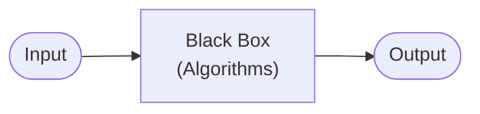
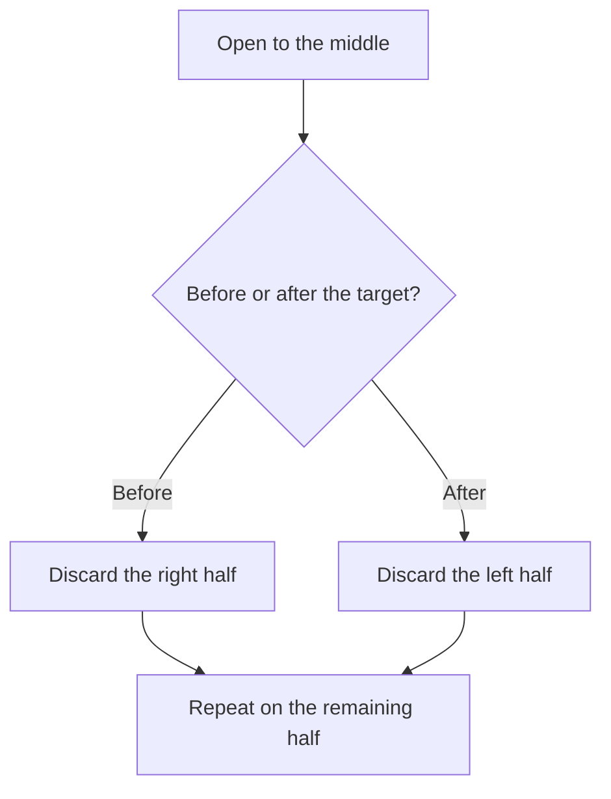

# CS50x — Lecture 0: Introduction to Computer Science & Scratch

> **Course:** CS50x — Introduction to Computer Science
> **Instructor:** Prof. David J. Malan (Harvard University)
> **Lecture:** 0 — Scratch

A concise set of notes covering computational thinking, data representation, algorithms, and visual programming with Scratch.

---

## Table of Contents

1. [Course Overview & Core Philosophy](#1-course-overview--core-philosophy)
2. [Computational Thinking & Problem Solving](#2-computational-thinking--problem-solving)
3. [Data Representation: From Bits to Bytes](#3-data-representation-from-bits-to-bytes)
4. [Representing Complex Data Types](#4-representing-complex-data-types)
   - [Text Representation](#text-representation)
   - [Images & Colors](#images--colors)
   - [Video & Audio](#video--audio)
5. [Algorithms & Efficiency](#5-algorithms--efficiency)
6. [Pseudocode & Core Programming Constructs](#6-pseudocode--core-programming-constructs)
7. [Scratch Programming (MIT)](#7-scratch-programming-mit)

---

## 1. Course Overview & Core Philosophy

- **Core objective:** CS50x focuses on **problem-solving** and **computational thinking** — learning how to take inputs, process them, and produce correct outputs. Programming syntax is a side effect of mastering these foundational concepts.
- **AI as a co-pilot:**
  - AI tools such as ChatGPT, Gemini, and Claude are changing programming by helping write code, fix bugs, and implement new features.
  - Despite AI capabilities, humans must understand computer science fundamentals to stay in the driver's seat and direct technology effectively.
- **Academic policy & the CS50 Duck:**
  - Course policy directs students to CS50's dedicated AI assistant (`cs50.ai` / the Virtual Duck) rather than external AI models.
  - The Virtual Duck acts like a supportive human tutor, guiding students toward solutions without spoiling answers outright.

---

## 2. Computational Thinking & Problem Solving

- **Computer science** is the study of information — how it is represented and processed — and the application of computational thinking to real-world problems.

### The Problem-Solving Model

- **Input** — the problem statement or raw data.
- **Black box** — the algorithm or process that converts inputs to outputs.
- **Output** — the desired solution or result.

---

## 3. Data Representation: From Bits to Bytes

Computers operate strictly using binary states (zeros and ones) driven by electrical voltage levels.

### Number Systems

| System | Base | Digits | Place values |
| :--- | :---: | :--- | :--- |
| **Unary** | 1 | Tally marks / fingers | One mark per object (e.g., counting 1–5 on one hand) |
| **Decimal** | 10 | $0$–$9$ | Powers of 10: $10^0 = 1$, $10^1 = 10$, $10^2 = 100$ |
| **Binary** | 2 | $0$ and $1$ | Powers of 2: $2^0 = 1$, $2^1 = 2$, $2^2 = 4$, $2^3 = 8$, $2^4 = 16$, $2^5 = 32$, $2^6 = 64$, $2^7 = 128$ |

### Hardware Foundations

- **Bits & transistors:** A **bit** (binary digit) represents a single $0$ or $1$. Transistors act as microscopic switches — electricity flowing represents $1$ (light bulb ON), and no current represents $0$ (light bulb OFF).
- **Bytes:** A group of **8 bits** equals **1 byte**.
  - 8 bits can represent values from $0$ ($00000000_2$) to $255$ ($11111111_2$), giving $256$ total unique combinations ($2^8 = 256$).

> [!NOTE]
> Binary literals are often written with a subscript, e.g. $(11111111)_2 = 255_{10}$.

- **Data sizes:**

| Architecture | Unique values | Signed range |
| :--- | :--- | :--- |
| **32-bit** | $2^{32} \approx 4$ billion | $\pm 2$ billion |
| **64-bit** | $2^{64}$ permutations | — |

64-bit architecture is standard in modern devices.

---

## 4. Representing Complex Data Types

Since computers only understand binary, all media types must be mapped to numbers via standardized conventions.

### Text Representation

#### ASCII

**ASCII** (American Standard Code for Information Interchange) uses 7 or 8 bits per character, supporting 128 to 256 characters.

| Character | Decimal | Binary |
| :---: | :---: | :---: |
| `A` | 65 | `01000001` |
| `B` | 66 | `01000010` |
| `a` | 97 | `01100001` |

> [!TIP]
> **Case-conversion trick:** Lowercase letters are exactly $32$ ($2^5$) higher than their uppercase counterparts. Toggling the bit in the $32$'s place converts between upper and lower case.

#### Unicode

- Expanded standard supporting world languages, accented characters, and emojis using 16, 24, or 32 bits per character.
- Emojis (e.g., "Face with Tears of Joy") are standardized numeric codes. Its code point is `U+1F602`; in UTF-8 it is encoded as `F0 9F 98 82`, which equals $4{,}036{,}991{,}106$ when read as a 32-bit value. Vendor platforms (Apple, Google, Telegram) render distinct graphics/fonts for the same code.

### Images & Colors

- **RGB color model:** Colors are formed by mixing red, green, and blue light.
  - Each channel uses 1 byte (8 bits, range $0$–$255$).
  - Total per pixel: 3 bytes (24 bits).
- **Pixels:** Individual colored dots forming a grid. Image file sizes scale with pixel count:

  $$\text{width} \times \text{height} \times 3\ \text{bytes}$$

| Color | RGB |
| :--- | :--- |
| Pure black | $(0, 0, 0)$ |
| Pure white | $(255, 255, 255)$ |
| Yellow | $(255, 255, 0)$ |

### Video & Audio

- **Video:** Sequences of still images (frames) displayed rapidly — typically 30 frames per second — to create the illusion of motion.
- **Audio:** Sound represented by digital values tracking pitch/frequency, duration, and volume/amplitude.

---

## 5. Algorithms & Efficiency

An **algorithm** is a step-by-step sequence of instructions for solving a problem.

### Case Study: Phonebook Search ("John Harvard")

| Approach | Strategy | Time complexity | Notes |
| :--- | :--- | :---: | :--- |
| **Linear search** (1 page at a time) | Turn pages sequentially from start to finish | $O(n)$ | Correct but slow |
| **Linear search** (2 pages at a time) | Turn pages two at a time | $O(n/2)$ | Twice as fast, but requires step verification to avoid skipping the target |
| **Binary search** (divide & conquer) | Open to the middle, check the name, discard half, repeat | $O(\log_2 n)$ | Highly efficient; doubling a 1,000-page phonebook adds only 1 step |

---

## 6. Pseudocode & Core Programming Constructs

**Pseudocode** is a human-readable, precise outline of code logic.

| Construct | Purpose | Examples |
| :--- | :--- | :--- |
| **Functions** | Actions or verbs that execute tasks | `pick up`, `open to`, `say` |
| **Conditionals** | Decision branches | `if`, `else if`, `else` |
| **Boolean expressions** | Questions returning true/false ($1$/$0$) | `touching mouse pointer?` |
| **Loops** | Cycles executing statements repeatedly | `repeat`, `forever`, `go back to` |
| **Variables** | Named storage containers for dynamic values | `prompt`, `answer`, `score` |

---

## 7. Scratch Programming (MIT)

Scratch is a visual, drag-and-drop block language developed by MIT to teach core programming logic without syntax errors.

### Scratch Environment

| Area | Purpose |
| :--- | :--- |
| **Blocks Palette** | Categorized, color-coded blocks: Events, Looks, Sound, Sensing, Control, Operators, Variables |
| **Coding Area** | Workspace where blocks snap together magnetically |
| **Stage & Sprites** | Visual world on an $X, Y$ plane ($-240 \le X \le 240$, $-180 \le Y \le 180$) where sprites execute scripts |

### Core Concepts

#### 1. Side Effects vs. Return Values

| Block | Behavior |
| :--- | :--- |
| `say [Hello, world!]` | Function with a visual **side effect** (speech bubble) |
| `ask [What's your name?] and wait` | Function that **returns a value**, stored in the variable `answer` |
| `join [Hello, ] [answer]` | Nested operator function combining text strings |

#### 2. Refactoring & Custom Blocks (Abstraction)

- Replacing duplicate blocks with a loop (`repeat [3]`) improves design and maintainability.
- **Custom blocks** (`define meow [n]`) encapsulate implementation details, making code modular and reusable.

#### 3. Concurrency & Event Listeners

- `when green flag clicked` — event handler that initiates execution.
- `forever` — continuous loop polling conditions (e.g., `if touching mouse pointer then play sound meow`).

#### 4. Multi-Sprite Game Implementations

| Project | Concepts demonstrated |
| :--- | :--- |
| **Oscar Time** | Sprite costumes, falling trash motion ($Y$ decrement), collision detection (`touching Oscar`), draggable properties, and score variables |
| **Ivy's Hardest Game** | Arrow-key handlers, boundary bouncing mechanics, autonomous enemy movement loops, and homing algorithms (`point towards Harvard`) |

---

*Notes based on CS50x Lecture 0 by Prof. David J. Malan (Harvard University).*
